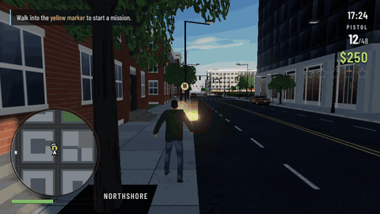

# PORT AURORA

GTAシリーズに着想を得た、ブラウザで遊べる都市型3Dオープンワールドゲームです。夕暮れの港町「Port Aurora」を歩いて、盗んだ車で走り、撃ち合い、警察から逃げ切ってください。原作のキャラクター・地名・地図は一切使っていません。街、店、車、ストーリーはすべてオリジナルです。



> `docs/demo.gif` は実際に動いているゲームの録画です（下の「デモGIFについて」を参照）。

**▶ ブラウザで遊ぶ：https://onego15.github.io/gta-claude/**（PCのChrome / Edge / Firefox推奨）

## ゲーム紹介

- **街**：4×4ブロックの碁盤の目と、それを囲む海沿いのプロムナード、西側の港湾地区からなるコンパクトな街です。
  - エリア：住宅街、商店街、オフィス街、公園、警察署、広場、病院、ガソリンスタンド、コンテナヤード。
  - 建物：レンガのウォークアップ、店舗付き中層ビル、ガラスのタワーなどの建築様式があります。
  - 店舗：ショーウィンドウ、看板、オーニング（日よけ）、ネオンがあります。
  - 道路設備：街灯、信号機（歩行者信号付き）、横断歩道、停止線、消火栓、ゴミ箱、パーキングメーター、バス停、街路樹、ヤシの木があります。
- **人々**：MakeHuman系のリアル体型のキャラクターが21種類います（主人公、一般市民15種、ギャング3種、警官2種）。
  - 歩行者は歩道を歩き、信号を待って横断歩道を渡ります。立ち止まって電話をしたり雑談したりもします。
  - 銃声、爆発、暴走車には、逃げる・しゃがみ込むといった反応をします。
- **車**：セダン、ハッチバック、SUV、バン、スポーツカー、ピックアップの6車種に、パトカーとタクシーの塗装があります。
  - ボディを1から自作して造形しました（ホイールアーチ、傾斜したフロントガラス、開くドア付き）。
  - 交通AIは車線を走り、信号で止まり、車間距離を保ち、交差点で曲がります。
  - 乗るときはドアを開けて乗り込み、ドアを閉めます。降りるときも同じ動作が入ります。
  - 運転にはドリフト、サスペンションの揺れ、衝突ダメージ、炎上・爆発があります。
- **銃撃戦**：ピストルとSMGを使えます。
  - エイム（肩越しTPSカメラ）、マズルフラッシュ、反動、着弾エフェクト、ヒットマーカー、弾数・リロード、体力・アーマーがあります。
  - 敵はコンテナや車を遮蔽物にして、身を隠す・顔を出して撃つ・回り込むといった行動をとります。
- **手配度（★1〜5）**：発砲、市民への暴行、カージャック、警官への攻撃、爆発で上がります。
  - パトカーは道路網を経路探索して追跡し、近くまで来ると警官が降りて応戦します。
  - ★1では逮捕を狙ってきます。★3以上ではパトカーが体当たりし、車内から発砲します。★4以上では警官がSMGを使います。
  - 一般車はサイレンを鳴らしたパトカーに道を譲ります。
  - 警察の視界から一定時間外れると★が下がり、追跡が終わると街は通常の状態に戻ります。
  - 死亡すると病院、逮捕されると警察署からリスポーンし、罰金がかかります。
- **ミッション**：3本あり、順番に解放されます。
  1. **Clean Getaway**：スポーツカー「Vortex」を時間内に港まで届けます（運転）。
  2. **Dockside Sweep**：コンテナヤードを占拠したギャング7人を倒し、現金ケースを回収します（銃撃戦）。
  3. **Hot Package**：ガソリンスタンドで荷物を拾うと罠で★3になるので、警察を振り切ってセーフハウスのガレージへ逃げ込みます（逃走）。
- **時間帯**：1日はゲーム内で24分です。夕焼けから夜へ移ると、窓・店・ネオン・街灯・信号が灯ります。
- **UI**：レーダー型ミニマップ（GPSルート、警察の捜索範囲、各種アイコン付き）、全体マップ、★表示、体力/アーマー、所持金、時計、速度計、目的テキスト、字幕があります。
  - MISSION PASSED / WASTED / BUSTED の演出があります。
  - タイトル画面とポーズ画面があります。

## 操作方法

| 徒歩 | | 運転 | |
|---|---|---|---|
| W A S D | 移動 | W | アクセル |
| マウス | 視点 | S | ブレーキ／バック |
| Shift | ダッシュ | A / D | ハンドル |
| Space | ジャンプ | Space | ハンドブレーキ（ドリフト） |
| 右クリック | エイム | H | クラクション |
| 左クリック | 射撃 | G | サイレン（パトカー） |
| R | リロード | F | 降車 |
| Q / ホイール / 1・2 | 武器切替 | | |
| C | しゃがみ | | |
| F / Enter | 乗車（運転手がいれば奪う） | | |
| M | 全体マップ | | |
| Esc / P | ポーズ | | |

黄色いマーカーに入るとミッションが始まります。ゲームパッドは移動と視点のみ対応しています。

## 起動方法

インストールなしで遊ぶ場合は https://onego15.github.io/gta-claude/ を開いてください。`main` に push すると GitHub Actions（`.github/workflows/pages.yml`）がビルドして GitHub Pages に公開します。

ローカルで動かす場合は Node.js 20以上が必要です。

```bash
npm install
npm run dev        # http://localhost:5173 を開く
# 配布用ビルド
npm run build      # dist/ を任意の静的サーバで配信（相対パスなのでサブフォルダでも動作）
npm run preview
```

URLオプション：
- `?time=21` で開始時刻を指定できます。
- `?freeze` で時間経過を止めます。
- `?lowres` でピクセル比1にして負荷を下げます。

## 使用技術

- **エンジン**：[Three.js](https://threejs.org/) 0.186（WebGL2）とVite 8を使い、JavaScriptで自作しました。外部の物理エンジンは使っていません。
- **描画**：
  - ACESトーンマッピング、UnrealBloom、PCFシャドウ（プレイヤー追従）を使っています。
  - 空はPreetham Skyと雲で描き、輝度は圧縮しています。そこから生成したPMREM環境マップを0.15ゲーム時間ごとに更新し、車体などの反射に使っています。
  - フォグ、夜空と星、遠景の山とスカイラインがあります。
- **街の生成**：シード付き乱数で、毎回同じ街を生成します。
  - ファサード、店舗、看板、路面、横断歩道などのテクスチャはCanvasで生成しています。
  - 建物はマテリアルごとにジオメトリを結合し、小物はInstancedMeshにして、街路樹は風で揺らしています。
- **人物**：
  - 体はhumanforge（MakeHuman / MPFB2、CC0）で生成し、ブラウザ上でGLBに焼き込み、gltf-transformで量子化しました。
  - アニメーションはQuaternius Universal Animation Library（CC0）の40クリップを使っています。UEマネキンのボーン構成から、自作のリターゲッタでMixamo系のボーン構成に移しました。
  - 再生時は下半身と上半身を別々にブレンドします。歩きながらのエイム、上下のエイム角、被弾リアクションに使っています。
  - 遠くのキャラクターはアニメーションの更新頻度を下げ、視錐台カリングも行っています。
- **車**：断面をつないでボディを作る自作ジェネレータです。テンプレートを車種・塗装ごとに1回だけ作り、それを複製して使います。ボディの部品はマテリアルごとに結合しています。物理はアーケード型の自転車モデルで、壁とは向きを考慮した箱とAABBの分離軸判定、車同士は向きを考慮した箱どうしの判定とインパルスで計算しています。
- **AI**：
  - 交通：車線グラフ上をPure Pursuitで追従し、2フェーズの信号に従い、前方の車や人を検知して減速し、詰まったら脱出します。
  - 警察：Dijkstraで経路探索して追跡し、近づくと直接追います。
  - 歩行者：歩道グラフを歩き、信号を待ち、パニックになると逃げます。
  - 戦闘：遮蔽物を探し、身を隠す・撃つ・移動するという状態遷移で動きます。
- **サウンド**：銃声、爆発、跳弾、足音、ドア、クラクション、サイレン、街の環境音、ミッション成功・失敗の音はWebAudioで生成しています。エンジン音、スキッド音、衝突音はKenneyのCC0素材です。距離減衰、ステレオ定位、遠い音のローパス処理をかけています。
- **UI**：DOMとCanvasで作っています。フォントはAntonとBarlow Condensed（@fontsource、OFL）です。

### 外部アセットとライセンス

| 素材 | 出典 | ライセンス |
|---|---|---|
| 人物モデル（ベースメッシュ、服、髪、テクスチャ） | MakeHuman / MPFB2 アセット（humanforge 経由） | CC0 |
| 人物アニメーション | Quaternius — Universal Animation Library 1 & 2 (Standard) | CC0 |
| ピストル / SMG モデル | Kenney — Weapon Pack | CC0 |
| エンジン・スキッド・衝突音 | Kenney — Starter Kit Racing | CC0 |
| フォント | Anton, Barlow Condensed（@fontsource） | SIL OFL 1.1 |

上記以外（街、建物、店、看板、車、エフェクト、UI、効果音の大部分）は、すべてこのリポジトリのコードで生成しています。

## AIサービスとモデル

- AIサービス：**Claude Code**（Anthropic）
- モデル：**Claude Opus 5.5**

## 制作記録

- 制作開始：2026-10-20 23:48:26 UTC
- 制作終了：2026-10-21 05:54:51 UTC
- 経過時間：6時間6分25秒

### 実施したテスト

テストはすべてヘッドレスChromium（Playwright、SwiftShaderによるソフトウェアWebGL）上で行いました。実際のゲームを `tools/play.mjs` で自動操作し、仮想キー・マウス入力とフレームを固定刻みで進める方式で、各段階のスクリーンショットとログを確認しました。

- **車の乗降**：ドアを開けて乗り込み、閉めて運転し、停車して降りるまでを、側面からの連番フレームで確認しました。
- **運転**：加速、旋回、ブレーキ、バック、壁や車との衝突ダメージ、炎上から爆発、焼け跡の残骸までを確認しました。
- **交通AI（60秒シミュレーション）**：赤信号の停止線で停止し、後続車が車間を空けて並ぶことを確認しました。軽い接触は少し発生しました。
- **歩行者**：歩行信号を待って横断歩道を渡ること、発砲で逃げる・しゃがむ反応をすることを確認しました。
- **銃撃**：エイム時の構え、銃の持ち方（手のボーンに合わせて調整）、マズルフラッシュ、命中、ヒットマーカー、弾数、リロードを確認しました。
- **手配度と警察**：
  - 発砲で★1になり、警察が出動し、視界から外れて★が下がって解除されるまでを確認しました。
  - ★3では警官が降車して応戦し、WASTEDからリスポーンまでを確認しました。
  - ★1で逮捕（BUSTED）され、警察署からリスポーンすることを確認しました。
- **高手配度での追跡（★4、60秒、プレイヤー車は自動運転）**：パトカーが追いつき体当たりすること、遠く離れたユニットが入れ替わることを確認しました。JSエラーは0件で、車と人の数も安定していました。
- **ミッション**：3本とも開始からクリアまで確認しました。
  - 移動の一部はテレポートで短縮しています。
  - ミッション2の敵の全滅は、デバッグ操作で確認しました。
- **描画負荷**：ドローコールは2111から1199に減りました（車体の結合、キャラクターのカリング、影を落とすメッシュの選別による）。更新処理は1フレームあたり約2msです。

### グラフィック・UIの改善内容

- **空と光**：低い太陽での逆光の白飛びを解消しました（空の輝度スケールとハイライト圧縮、ブルーム閾値の見直し）。夜の環境光を明るくし、街灯の光だまりを歩道の上に描くようにしました。
- **車**：
  - ボディ作成のループ処理の面の向きと、ねじれたポリゴンを修正しました。
  - 塗装テクスチャを左右に分け、POLICE／TAXIの文字が反転しないようにしました。
  - ヘッドライトの質感を調整しました。
- **人物**：
  - 服の色替えがはみ出す問題と、Tシャツのロゴを修正しました。
  - 腰の上下移動量をキャラクターの脚の長さに合わせました。
  - 銃の向き、持ち位置、大きさを手のボーンに合わせて調整しました。
- **カメラ**：壁際で画面が壁にめり込まないようにしました（肩越しのずらし量と左右の当たり判定）。乗車中も追従するように修正し、運転中は速度に応じてFOVと距離が変わり、自動で背後へ回り込みます。
- **UI**：
  - ミッションマーカーのアイコンを画面上で一定サイズにし、近くで巨大化しないようにしました。
  - タイトル画面の背景に街の空撮カメラを流すようにしました。
  - 全体マップのサイズ計算を修正しました。
  - クロスヘアは狙っている相手が敵なら赤、市民なら黄色になります。
- **AI**：
  - 敵がルートを塞がれて立ち往生しないようにしました。
  - 警察の到着前に手配度が下がらないよう、猶予時間を設けました。
  - パトカーに道を譲る挙動と、取り残されたユニットの入れ替えを追加しました。

### デモGIFについて

`docs/demo.gif` は、このゲームを上記の自動テスト環境で実際に動かして撮影したフレームを、ffmpegでGIFにしたものです。架空の映像や合成した映像ではありません。ただし、次の点に注意してください。

- 人が手で操作した映像ではありません。スクリプトで仮想入力を与えています。運転シーンでは、ゲーム内の交通AIが計算したスティック入力をプレイヤーの車に与えています（オートパイロット）。
- シーンの間はカットでつないでいます。カットのところで、プレイヤーを次のシーンの場所まで移動させています。
- 港への到着シーン（MISSION PASSED）だけは、同じスクリプトを別に実行して撮影したものに差し替えています。最初の撮影では、到着直前に車がコンテナにぶつかってしまいました。
- ソフトウェアレンダリングで撮影したので、実時間で再生したわけではありません。1フレームずつ固定刻み（約1/12秒）で進めて撮影しています。
- 音は録音していません。

### 検証できなかったこと・既知の制限

- **実GPUでの性能**：検証していません（ソフトウェアレンダリングのみ）。描画は重めで、街中で約1200ドローコールあります。古いGPUでは `?lowres` を推奨します。
- **音**：実際に耳では確認できていません。音のファイルの読み込みと再生処理がエラーなく動くことまでは確認しました。
- **マウス操作の手触り**：実機のマウスとポインタロックでの操作感は検証していません。ゲームパッドも未検証です。
- **人の手で通しで遊んだときの難易度**：検証していません。ミッションクリアの確認では、移動の短縮やデバッグ操作を使っています。
- **アニメーションの粗さ**：エイム中に横移動すると足が滑ります（横歩きのモーションがないため）。車の乗り込みは座る位置への移動とポーズのブレンドで表現しているので、ドア枠を体がすり抜けます。
- **見た目の制限**：拳銃はKenneyのローポリモデルです。

## 制作プロンプト全文

```
GTAシリーズに着想を得た、都市型3Dオープンワールドゲームを制作してください。
ブラウザでプレイ可能な、商業インディーゲームのような完成度を目指してください。
最も重視するのは、都会的で生活感のある3D街並み、自然な人間のキャラクターとアニメーション、車両の挙動、自由に街を探索できる楽しさです。
ゲーム内容

* 三人称視点で都市を自由に歩き回れる
* 道路、歩道、ビル、商店、公園などがある都市空間
* 歩行者や自動車が街の中を移動している
* 車に乗り降りして運転できる
* 街を探索しながら楽しめる小さなミッションやアクティビティ
* 歩行・運転の両方で快適なカメラ操作

グラフィック

* 単なる直方体を並べた都市ではなく、建築様式、道路設備、看板、店舗、窓、街路樹などが作り込まれた都市
* 歩行者は人間らしい体型と服装を備え、自然な歩行アニメーションを持つ
* 主人公にも人間らしいモデルとアニメーションを用意
* 車は自動車と分かる完成度のあるモデルを使用
* 光、影、反射、時間帯、環境音などで街の雰囲気を作る
* 世界観と調和したUI/UX

制作方針
3Dキャラクターや車両など、コードだけで高品質に制作するのが難しい素材については、外部アセットの活用を積極的に検討してください。
利用可能な無料・適切なライセンスの3Dモデル、テクスチャ、アニメーションなどを探し、必要に応じてゲームに組み込んでください。
ただし、ライセンスを遵守し、原作の固有キャラクターやマップをコピーしないでください。
大規模な都市や大量のミッションより、コンパクトでも作り込まれた、生活感のある街を優先してください。
エンジン、言語、フレームワーク、アートスタイルは自由です。
制作途中の確認は不要です。実装後はゲームを実際に動かし、特に人物の見た目、歩行、車の乗降、運転、交通AI、カメラの挙動をテストして改善してください。

品質改善・自律制作（最重要）
ゲームが動作するようになった段階では、まだ完成ではありません。
基本機能の実装後、グラフィック、アニメーション、演出、UI/UX、ゲームバランスを改善する工程を必ず設けてください。
特に以下を徹底してください。

* 機能が実装されたことだけを理由に完成と判断しない
* 実際にゲームを起動してスクリーンショットを確認し、見栄えの悪い部分を改善する
* プリミティブな図形や仮素材を使った場合は、最終的に作品の世界観に合う素材へ置き換える。ただし意図的なアートスタイルとして成立している場合は除く
* 背景、キャラクター、建物、UI、アニメーション、音響まで一貫したアートディレクションを行う
* 可能な限り実際にゲームをプレイし、操作性、ゲーム進行、難易度、演出を検証する
* 初回の実装で満足せず、発見した問題を修正し、再確認するサイクルを繰り返す
* 制作時間の短縮よりも最終的なゲーム品質を優先する
* コンテンツ量を増やすより、少ない要素を高品質に仕上げる
* 利用可能な作業時間・ツール・実行予算の範囲内で、可能な限り完成度を高める

目標は動作する技術デモではなく、人が遊んで楽しいと感じる、視覚的にも完成されたゲームです。
私への途中確認は不要です。制作、動作確認、改善まで自律的に実施してください。検証できなかった項目は完了したと装わず、正直に報告してください。
README・制作記録
README.mdにはゲーム紹介、実際のプレイ映像から作ったGIF（docs/demo.gif）、操作方法、起動方法、使用技術、AIサービス名、正確なモデル名、制作プロンプト全文を記載してください。
加えて、制作開始・終了日時、経過時間、実施したテスト、グラフィックやUIの改善内容も、確認できる範囲で記録してください。
GIFは実際に動作するゲームの録画を使用し、架空のプレイ映像で代用しないでください。録画できない場合はその旨を明記してください。

### 銃撃・戦闘システム
- プレイヤーが銃を装備し、照準を合わせて射撃できる
- 射撃時のマズルフラッシュ、反動、発射音、着弾エフェクトを実装する
- 弾数、リロード、HPなどの基本的な戦闘システムを用意する
- 敵NPCとの銃撃戦を楽しめる
- 敵NPCは移動、遮蔽物の利用、攻撃などの行動を取る
- 戦闘時には三人称シューティングに適したカメラワークに切り替わる
- 過度にリアルな暴力描写よりも、ゲームとしての爽快感と遊びやすさを優先する

### 指名手配・警察システム
GTAシリーズのように、プレイヤーの行動によって指名手配レベルが変化するシステムを実装してください。

- 発砲、車両の強奪、警察への攻撃などで指名手配レベルが上昇する
- 指名手配レベルを星（★）で表示する
- レベルに応じて警察官やパトカーの数、追跡の積極性が変化する
- 警察はプレイヤーを発見すると追跡し、状況に応じて攻撃する
- 車での逃走や徒歩での逃走が可能
- 警察の視界から逃れて一定時間隠れると、指名手配レベルが低下する
- 逮捕・死亡時には適切なペナルティとリスポーン処理を行う
- 警察の追跡が終わった後は、通常の街の状態に戻る

### 街のNPC・交通AI
- 歩行者が街を自然に歩き回る
- NPCは発砲や危険な運転に反応し、逃げるなどの行動を取る
- 自動車が道路に沿って走行し、交差点などで自然に振る舞う
- パトカーは道路を利用してプレイヤーを追跡する
- 戦闘や警察の追跡が起きても、街全体のシミュレーションが破綻しないようにする

### ミッション
自由探索に加えて、銃撃・運転・警察からの逃走を楽しめる短いミッションを用意してください。

例：
- 指定された目的地まで車で移動する
- 敵NPCと銃撃戦を行う
- 警察の追跡から逃れて安全な場所に到達する

ミッションはコンパクトでも構いませんが、開始からクリアまで正常に進行することを重視してください。
```
